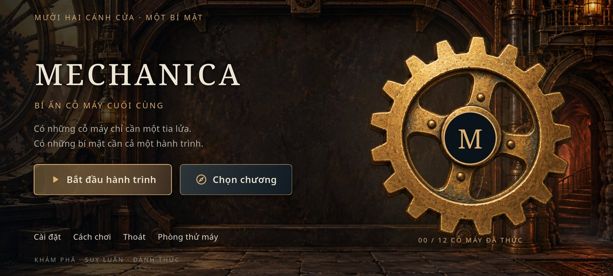
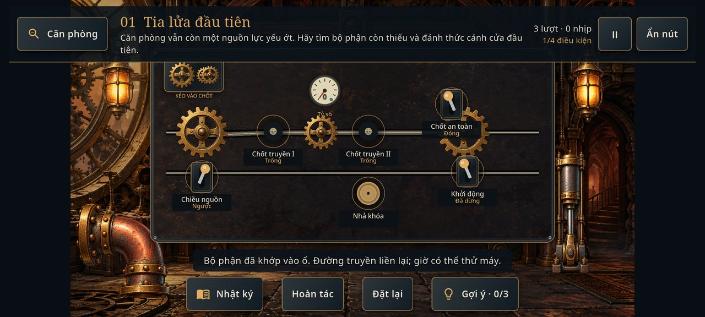
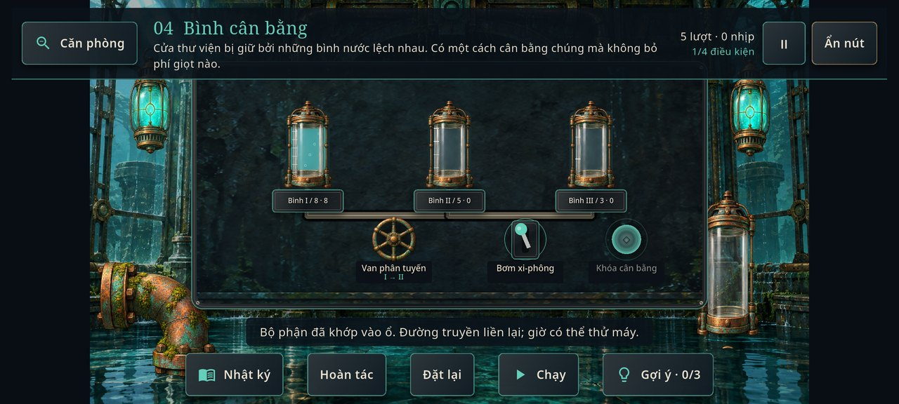
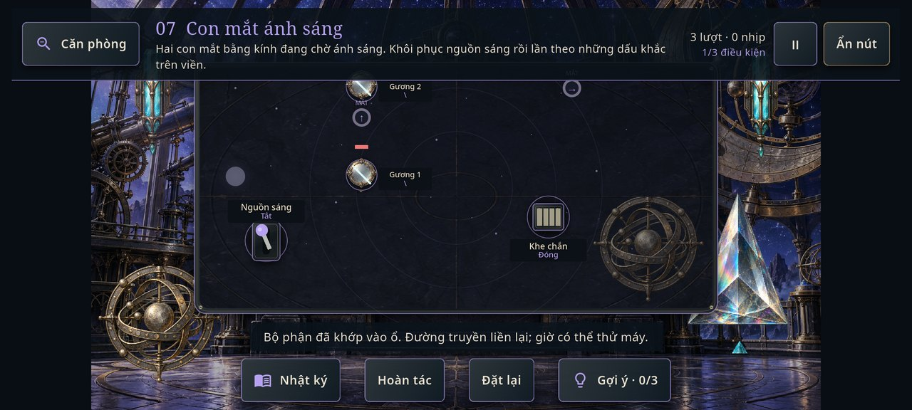
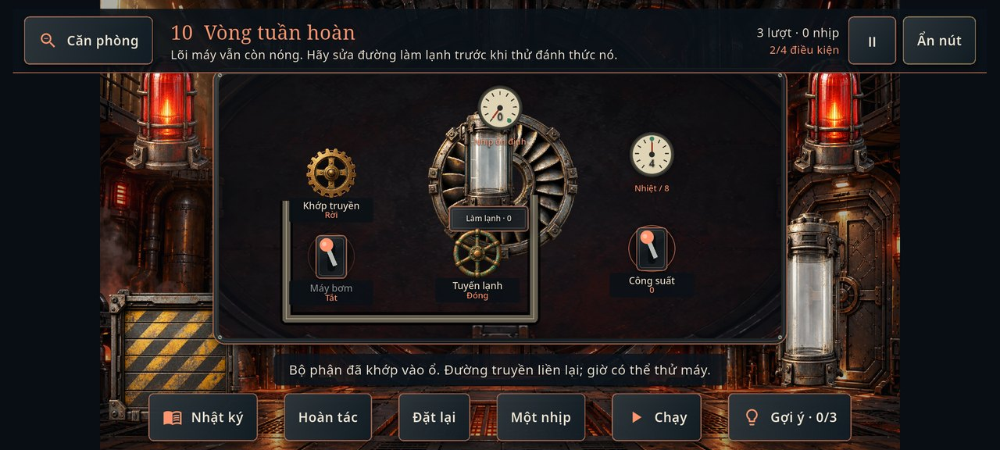
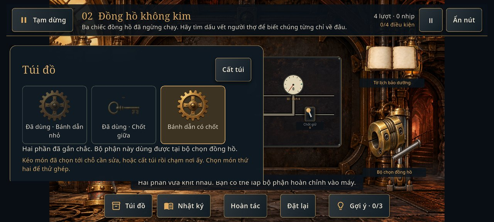

# MECHANICA — Bí Ẩn Cỗ Máy Cuối Cùng

Game phiêu lưu giải đố cơ khí 2D bằng **Flutter, Dart và Flame**, dành cho Android màn hình ngang. Người chơi khám phá những căn phòng bỏ quên, đọc dấu vết của người thợ, tìm bộ phận thay thế và đưa các cỗ máy trở lại hoạt động để mở đường tới lõi cuối cùng.

Dự án phục vụ đồ án môn **Lập trình trên thiết bị di động**. Phiên bản trong source: **1.1.0+2**. Game chạy offline, nội dung hiển thị bằng tiếng Việt; không cần tài khoản, API key hay backend.

## Trải nghiệm và tính năng

- **4 chương, 12 màn** nối tiếp, có điều kiện mở khóa, đánh giá 1–3 sao và đoạn kết.
- Khám phá phòng qua hotspot, nhìn cận cảnh máy, xem vật phẩm và ghi lại manh mối trong nhật ký.
- Túi đồ hỗ trợ nhặt, xem, chọn, kéo sử dụng, ghép hai bộ phận khi màn yêu cầu và đánh dấu đồ đã dùng.
- Các cơ chế bánh răng, hơi nước, bảo toàn/lọc nước, tia sáng và cân bằng nhiệt có trạng thái và quy tắc chuyển xác định.
- Chuyển động bánh răng, kim, van, nước, tia và cửa phản ánh trạng thái; thao tác sai có phản hồi và cách khôi phục.
- Ba cấp gợi ý, hoàn tác, đặt lại màn, hướng dẫn theo ngữ cảnh và sổ tay trong game.
- Lưu tiến trình giữa màn, sao, manh mối, vật phẩm và cài đặt trên thiết bị; hỗ trợ bản lưu cũ và bản dự phòng.
- 4 bản nhạc nền theo chương, 19 hiệu ứng âm thanh; điều chỉnh BGM/SFX riêng, bật/tắt nhạc và giảm chuyển động.
- **Developer Mode chỉ ở debug build**, truy cập đủ 12 màn và dùng dữ liệu thử riêng.

## Bốn chương

| Chương | Các màn | Trọng tâm giải đố |
|---|---|---|
| I — Xưởng Đồng Hồ | Tia lửa đầu tiên; Đồng hồ không kim; Trái tim lò hơi | Tỷ số và chiều quay, cặp đồng hồ cùng tiến, tích và sử dụng hơi |
| II — Thư Viện Chìm | Bình cân bằng; Nước qua ký ức; Cánh cửa thủy áp | Đong nước, sạch/đục, lọc hữu hạn, giữ cân bằng rồi xả |
| III — Đài Thiên Văn | Con mắt ánh sáng; Sắc phổ vỡ; Bản đồ tinh tú | Hướng phản xạ, khe chắn, màu/cường độ, ghi nhớ hai pha |
| IV — Lõi Vĩnh Cửu | Vòng tuần hoàn; Ba khóa an toàn; Cỗ máy cuối cùng | Nước lạnh và công suất, khóa phụ thuộc, chuỗi ổn định |

## Hình ảnh chạy thực tế

Ảnh dưới đây được lấy từ lượt chạy trên Android emulator, thu nhỏ và nén JPEG để lưu trong repository. Không dùng ảnh concept để thay cho ảnh gameplay.



| Xưởng Đồng Hồ | Thư Viện Chìm |
|---|---|
|  |  |
| Đài Thiên Văn | Lõi Vĩnh Cửu |
|  |  |



## Công nghệ và môi trường

| Thành phần | Phiên bản đã dùng |
|---|---|
| Flutter / Dart | 3.47.7 / 3.13.5 |
| Flame | 1.38.2 |
| flame_audio | 2.12.2; audioplayers 6.8.1 là phụ thuộc bắc cầu |
| shared_preferences | 2.5.6 |
| cupertino_icons | 1.0.9 trong lockfile |
| Kiểm thử | flutter_test, integration_test từ Flutter SDK; flutter_lints 6.0.0 |
| Android | min SDK 24, compile/target SDK 36 ở môi trường đã build |
| Công cụ Android | AGP 9.1.0, Kotlin 2.4.0, Gradle 9.3.1; Java đi kèm Android Studio |

Cần Flutter SDK tương thích `sdk: ^3.13.5`, Android SDK có license và điện thoại bật USB debugging hoặc emulator. Môi trường đã dùng Flutter 3.47.7 và JBR 25 của Android Studio; source JVM target là 17. Các phiên bản package được khóa trong `pubspec.lock`. Python + Pillow/NumPy chỉ cần khi chạy công cụ xử lý asset, không cần để chơi hay build Flutter thông thường.

## Cài đặt và chạy Android

Tải hoặc clone repository, mở terminal tại thư mục chứa `pubspec.yaml`:

```sh
flutter doctor -v
flutter doctor --android-licenses
flutter pub get
flutter devices
flutter run -d <device-id>
```

Thay `<device-id>` bằng ID từ `flutter devices`, ví dụ `emulator-5554`. `flutter pub get` chuẩn bị phụ thuộc và cấu hình Flutter local; không copy `android/local.properties` từ máy khác. Lần tải package/Gradle đầu cần mạng; game đã cài có thể chơi offline.

Nếu thiết bị đang có APK với version code cao hơn, Android có thể từ chối cài bản thấp hơn. Hướng xử lý giữ dữ liệu và bản debug code 5002 từng dùng trong Phase 2 nằm ở [DEV_GUIDE](docs/DEV_GUIDE.md).

## Build APK

```sh
flutter build apk --release
```

APK tổng hợp ABI: **`build/app/outputs/flutter-apk/app-release.apk`**. Để có APK nhỏ hơn theo kiến trúc:

```sh
flutter build apk --release --split-per-abi
flutter build apk --debug
```

Release hiện dùng **debug signing của máy build** để cài/nộp đồ án. Chưa cấu hình khóa production hoặc phát hành Play Store. Không đưa APK, keystore hay thư mục `build/` vào GitHub; gửi APK riêng khi nộp bài.

## Cách chơi và cảm ứng

1. Chạm lời nhắn, tờ ghi chú, ngăn kéo hoặc vật thể trong phòng để quan sát.
2. Tìm manh mối và bộ phận còn thiếu. Trong **Túi đồ**, chạm để chọn; giữ để xem mô tả. Chọn món thứ hai để ghép khi phù hợp.
3. Chọn đồ rồi chạm vị trí cần sửa, hoặc kéo đồ tới vị trí đó.
4. Chạm bộ máy để nhìn gần. Chạm bánh răng/van/gương để đổi nấc; kéo cần để gạt. Màn đầu còn có kéo bánh từ khay vào chốt.
5. Theo dõi kim, mực nước, màu và đường tia. **Một nhịp** tiến một bước; **Chạy/Dừng** điều khiển nhịp tự động ở cơ chế hỗ trợ.
6. Dùng **Nhật ký**, **Gợi ý**, **Hoàn tác** hoặc **Đặt lại** khi cần. Hoàn thành màn sẽ mở màn kế tiếp, kể cả khi không đạt ba sao.

**Căn phòng** quay lại góc tổng thể. Android Back đóng túi đồ trước, tiếp theo thoát cận cảnh, rồi mở tạm dừng. Rời app sẽ dừng máy; bấm **Tiếp tục** để chơi lại sau gián đoạn. Chi tiết: [GAMEPLAY](docs/GAMEPLAY.md).

## Developer Mode

Chạy bản debug, chọn **Phòng thử máy** tại menu chính. Có thể mở trực tiếp cả 12 màn; trong màn chọn **Thử** để xem điều kiện thắng/trạng thái, đặt lại, hoàn tác và bật lớp vùng chạm. **Xóa dữ liệu thử** chỉ xóa namespace thử; **Về hành trình thật** quay về save thường. Truy cập màn không tự cấp sao.

UI và lệnh debug đều được chặn bởi `kDebugMode`; menu này không xuất hiện ở release. Xem [DEV_GUIDE](docs/DEV_GUIDE.md).

## Cấu trúc dự án

```text
lib/
  app/             Controller và điều phối tiến trình
  core/            Lưu local và âm thanh
  game/            Flame room, rendering, puzzle reducer, cơ chế cơ khí/quang học
  ui/              Menu, phòng, túi đồ, cài đặt, kết thúc, Developer Mode
assets/            Dữ liệu 12 màn, hình, WAV, font và manifest
android/           Android host, manifest, launcher icon và Gradle
web/               Scaffold Flutter web; chưa thuộc nền tảng nghiệm thu
art_sources/       Hai atlas nguồn Phase 2 do dự án tạo
test/              Unit/widget test
integration_test/  Kiểm thử trên Android
test_driver/       Driver nhận screenshot từ integration test
tools/             Tạo/kiểm tra dữ liệu và asset
docs/              Tài liệu kỹ thuật, thiết kế, QA và screenshot chọn lọc
```

## Kiểm thử và tài liệu

```sh
flutter pub get
dart format --output=none --set-exit-if-changed .
flutter analyze
flutter test
flutter build apk --release
```

Kết quả được chạy thật và phạm vi Android được phân biệt trong [TESTING](docs/TESTING.md). Các integration test sử dụng dữ liệu app trên emulator thử nghiệm; bài kiểm tra hành trình **xóa save thường của app trước khi chạy**, vì vậy chỉ dùng thiết bị/snapshot dành cho QA.

- [ARCHITECTURE](docs/ARCHITECTURE.md): kiến trúc và luồng dữ liệu.
- [GAMEPLAY](docs/GAMEPLAY.md): quy tắc, thao tác và tiến trình.
- [TESTING](docs/TESTING.md): ma trận và kết quả kiểm thử.
- [ASSET_CREDITS](docs/ASSET_CREDITS.md): nguồn, giấy phép và danh sách âm thanh.
- [DEV_GUIDE](docs/DEV_GUIDE.md): môi trường, debug, build và tái tạo dữ liệu.
- [RELEASE_HANDOVER](docs/RELEASE_HANDOVER.md): kết quả bàn giao cuối và danh sách đưa lên GitHub.

## Nguồn và giấy phép asset

Art được tạo riêng bằng công cụ sinh ảnh và tích hợp thành sprite/background; không gắn nhãn CC0 hoặc cam kết độc quyền. Audio được tổng hợp gốc bằng mã Python của dự án, không dùng sample/nhạc thương mại. Noto Sans/Noto Serif dùng **SIL Open Font License 1.1**; bản license đi kèm trong `assets/fonts/`.

Có 74 file trong manifest: 46 PNG, 4 BGM, 19 SFX, 2 font, 2 license và dữ liệu màn. [ASSET_CREDITS](docs/ASSET_CREDITS.md) ghi tên/nguồn chi tiết. Tư liệu trong `references/` có quyền phân phối chưa xác minh nên được giữ local và loại khỏi GitHub/APK. Repository chưa đặt license chung cho toàn bộ source/art; không suy diễn rằng mọi thành phần có cùng giấy phép.

## Giới hạn đã biết

- Bốn nền phòng dùng theo chương; bố cục khám phá còn lặp, nhiều thiết bị đặt trên mặt bảng cơ khí. Chưa có nhiều góc khám phá trong một phòng.
- Nhạc tổng hợp có loop 32 giây, chưa được mix/playtest trên nhiều loa và tai nghe.
- Chưa có playtest độc lập hoặc đo FPS trên điện thoại thật; không cam kết 60 FPS từ kết quả unit test.
- Android là nền tảng kiểm thử. Scaffold web chưa được xác nhận về cảm ứng, audio, lưu và hiệu năng.
- Release phục vụ cài thử/nộp bài, ký bằng debug key; chưa là bản phân phối cửa hàng.
