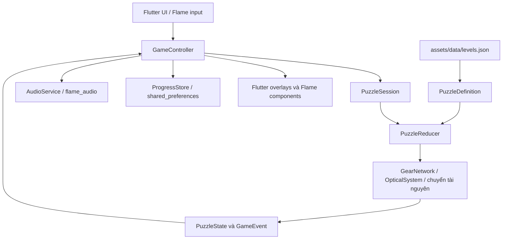

# Kiến trúc Mechanica

Tài liệu mô tả source 1.2.0+3. Flutter cung cấp UI và lifecycle; Flame vẽ môi trường, thiết bị và xử lý tương tác trong cảnh. Luật giải đố được đặt trong các lớp Dart riêng để kiểm thử mà không cần renderer.

## Luồng tổng thể

## Module và trách nhiệm

| Module | File chính | Trách nhiệm |
|---|---|---|
| Bootstrap | `lib/main.dart` | Landscape, immersive mode, tải JSON, preferences và audio; màn hình lỗi tải dữ liệu |
| Điều phối | `lib/app/controller.dart` | Điều hướng, thao tác người chơi, session, save, inventory, pause, Developer Mode |
| Mô hình | `lib/game/puzzles/model.dart` | Definition, state/action/event, control, item, hotspot và kiểm tra dữ liệu |
| Luật | `lib/game/puzzles/reducer.dart` | Guard → effect → derived/constraint → điều kiện thắng; history, undo, hint, sao |
| Cơ chế | `lib/game/mechanics/` | Mạng bánh răng, tỷ số hữu tỉ, tia quang giới hạn vòng lặp; DeviceMotion cho trình bày |
| Cảnh | `lib/game/mechanica_game.dart` | RoomScene, MachineAssembly, thiết bị cảm ứng, camera và asset cache riêng |
| Vẽ | `lib/game/rendering/drawing.dart` | Chữ, ánh sáng, ống và các primitive bổ trợ sprite |
| Flutter UI | `lib/ui/` | Menu, overlay, inventory, tutorial, settings, ending và debug menu |
| Persistence | `lib/core/persistence.dart` | JSON versioned, bản chính/dự phòng, hàng đợi ghi, validation và migration |
| Audio | `lib/core/audio_service.dart` | Một BGM loop, bốn voice SFX, fade và lifecycle |

Gameplay và save offline không phụ thuộc backend. V3 bổ sung Firebase Authentication và Firestore qua `CloudService` cho tài khoản và đồng bộ thành tích. State management dùng `ChangeNotifier`/`AnimatedBuilder`; không dùng Bloc/Riverpod.

## Chuyển trạng thái

`PuzzleSession` giữ state và history. Reducer trả `ValidationResult` gồm state mới, event và cờ chấp nhận. Thao tác máy bị chặn nếu chưa đọc lời nhắn hoặc chưa sửa bộ phận thiếu. Room action có guard riêng cho khóa ngăn, thu thập và ghép/sử dụng đồ.

`refresh()` tính lại mạng bánh răng, trường suy ra và tia quang trước khi đánh giá objective. Thao tác hợp lệ có thể kích hoạt constraint như quá áp, quá nhiệt hoặc mất liên động; constraint định nghĩa trạng thái cứu hộ. State thắng không nhận thêm thao tác thay đổi máy. Lời giải và trace sai nằm trong dữ liệu, được kiểm tra bằng test.

Cơ chế chạy tự động gọi một nhịp sau khoảng 0,85 giây khi đang chạy, không pause và đang nhìn gần. Animation cập nhật theo khung hình, không được dùng làm điều kiện thắng. Frame logic được giới hạn `dt` để ổn định trình bày; không suy ra cam kết FPS từ điều này.

## Tọa độ và tài nguyên

Camera dùng thiết kế 1280×720, giữ tỷ lệ và tạo vùng đệm khi aspect ratio khác. Hotspot lưu rectangle trong cùng tọa độ; vị trí kéo đồ được đổi từ tọa độ Flutter về thế giới Flame theo cùng phép scale. Mỗi cảnh giữ session riêng để tránh đọc session mới/null trong frame chuyển trang.

Background, prop và vật phẩm tải từ asset đã khai báo trong pubspec. Cache ảnh thuộc cảnh được giải phóng khi dispose. Lỗi hình ảnh được báo bằng thông báo phục hồi tiếng Việt; không dùng ảnh tham chiếu để fallback.

## Lưu và migration

Save schema 2 lưu màn mở, sao/lượt tốt nhất, gợi ý, tutorial, cài đặt và state đang chơi. Các trường item dùng 0: chưa nhặt, 1: đang giữ, 2: đã dùng. Không lưu state tia vẽ; reducer tính lại khi phục hồi.

Save thường dùng `mechanica_save_v1` và `mechanica_save_backup` (tên key giữ nguyên dù schema là 2). Namespace thử dùng `mechanica_development_v2` và `mechanica_development_backup`. Ghi được xếp hàng; lần ghi trước được giữ làm backup. Load parse/validate trước khi commit dữ liệu. Schema 1 được thêm trường phòng từ state khởi đầu khi restore; chưa đổi version chỉ vì lưu settings trước khi migration.

## Lifecycle và debug

`MechanicaApp` quan sát lifecycle. Ra nền: dừng máy/audio và lưu. Nếu đang chơi bị gián đoạn, quay lại vẫn cần người chơi tiếp tục. Cùng chương không khởi động lại BGM khi zoom; đổi chương dùng fade-out/fade-in. Nhạc tắt qua âm lượng 0; đây không phải cơ chế giải phóng player khi tắt nhạc.

`kDebugMode` bảo vệ menu và lệnh Dev trong controller. Đổi chế độ đổi store, đóng session hiện tại và về home. Truy cập màn thử không tự cấp thành tích cho save thường.

## Phạm vi nền tảng

Android manifest khóa `sensorLandscape`; main cũng yêu cầu hai hướng landscape. SDK thực tế, quyền hợp nhất và version của APK cuối được ghi tại [TESTING](TESTING.md). `web/` là scaffold, chưa là nền tảng nghiệm thu.

## Bổ sung V3

`GuidanceEngine`/`Onboarding` xác định mục tiêu hướng dẫn từ PuzzleState, inventory và zoom. `guidance_overlay.dart` đặt coach đối diện vật thể; renderer Flame vẽ highlight. `GuidanceEngine.next` chạy isolate, tối đa 3.500 trạng thái/220 ms; ưu tiên trace đã xác minh, có thể tìm đường về trace từ state khác. Không bịa thao tác khi hết ngân sách, trả hướng phục hồi.

`CloudService` mặc định khởi tạo bằng `DefaultFirebaseOptions` do FlutterFire tạo cho project test; có thể override options compile-time hoặc dùng debug Emulator với Firebase app riêng. `FIREBASE_OFFLINE=true` tắt cloud. `account.dart` chứa form/email validation/loading/error. `ProgressStore` thêm UID scope, optional outbox/best_seconds, vẫn đọc schema 1/2. `GameController` đổi store rõ ràng khi đăng nhập/xuất, hỏi nhập guest qua UI. State máy và settings local; Firestore chỉ hồ sơ, unlock và result/checkpoint.

Cloud transaction kết hợp max sao/min lượt/min thời gian, receipt create-only để một operation không tăng attempts hai lần. Queue tuần tự và outbox durable, retry sau 20 giây/resume/thủ công. `kDebugMode` bảo vệ Dev và Firebase Emulator; Dev store không sync. Tham khảo schema/rules và giới hạn trong [FIREBASE_SETUP](FIREBASE_SETUP.md).
