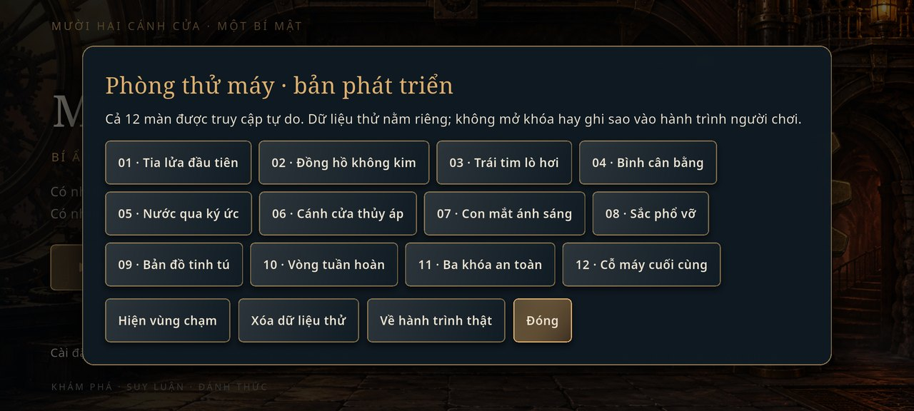

# Hướng dẫn phát triển và trình diễn

## Môi trường

Dùng Flutter 3.47.7 / Dart 3.13.5 để tái hiện môi trường đã kiểm tra. `pubspec.yaml` yêu cầu Dart `^3.13.5`; giữ `pubspec.lock` khi đưa ứng dụng lên GitHub. Android compile/target SDK của bản build hiện tại là 36, min SDK 24. Gradle 9.3.1, AGP 9.1.0, Kotlin 2.4.0; môi trường dùng JBR 25 đi kèm Android Studio, JVM target trong source là 17.

```sh
flutter doctor -v
flutter doctor --android-licenses
flutter pub get
flutter devices
flutter run -d <device-id>
```

SDK/Java có thể cần cấu hình theo máy; kiểm tra `flutter doctor -v` trước. Không đưa `android/local.properties`, đường dẫn Flutter/SDK local hoặc keystore vào Git. Gradle wrapper scripts/JAR và plugin registrant đang theo ignore của template Flutter; dùng Flutter CLI để chuẩn bị/build project, không chạy Gradle trực tiếp trước bước chuẩn bị Flutter.

Python 3 + Pillow và NumPy chỉ dùng cho tools. Cài tùy nhu cầu: `python -m pip install Pillow numpy`. Không cần Python khi build từ các asset đã có.

## Developer Mode trong debug

1. Chạy debug rồi chọn **Phòng thử máy** ở menu chính.
2. Chọn màn 01–12 bất kỳ, không cần sửa save hoặc chơi mở khóa trước.
3. Trong màn, bấm **Thử**: xem các objective và giá trị state, đặt lại máy, hoàn tác thử, hiện/ẩn vùng chạm.
4. **Xóa dữ liệu thử** có xác nhận, chỉ xóa namespace thử.
5. **Về hành trình thật** quay lại store người chơi.

Dữ liệu thử dùng `mechanica_development_v2` / `mechanica_development_backup`; dữ liệu thật dùng `mechanica_save_v1` / `mechanica_save_backup`. `kDebugMode` chặn cả menu và lệnh controller khi release; vào màn thử không tự cấp sao. Không dùng menu settings **Xóa tiến trình** trên hành trình thật nếu cần giữ dữ liệu.



## Build và version code

Source hiện là `1.2.0+3`. Lệnh release tiêu chuẩn:

```sh
flutter build apk --release
```

Kết quả: `build/app/outputs/flutter-apk/app-release.apk`. Có thể build split bằng `flutter build apk --release --split-per-abi`; ABI có thể được Flutter cộng offset vào version code. Release hiện ký bằng debug key local để cài thử đồ án, không cấu hình Play Store.

Phase 2 từng cài debug code **5002** để nâng lên trên release x86_64 split code **4002** mà giữ dữ liệu emulator. Nếu gặp `INSTALL_FAILED_VERSION_DOWNGRADE`, dùng build number cao hơn bản đang cài, ví dụ:

```sh
flutter build apk --debug --build-number=5003
adb install -r build/app/outputs/flutter-apk/app-debug.apk
```

Đổi build number không đảm bảo cập nhật được giữa hai máy dùng debug key khác nhau; Android cũng kiểm tra chữ ký. Gỡ app sẽ xóa save. Chỉ gỡ/reset trên thiết bị QA hoặc khi đã chấp nhận mất dữ liệu.

## Kiểm thử

```sh
flutter pub get
dart format --output=none --set-exit-if-changed .
flutter analyze
flutter test
flutter build apk --release
```

Nếu format check báo thay đổi, chỉ chạy `dart format lib test integration_test test_driver` rồi kiểm tra lại. Không format cache hay source package bên ngoài.

Kiểm thử Android trên emulator riêng:

```sh
flutter drive --driver=test_driver/integration_driver.dart --target=integration_test/phase2_playthrough_test.dart -d <device-id>
flutter drive --driver=test_driver/integration_driver.dart --target=integration_test/developer_test.dart -d <device-id>
flutter drive --driver=test_driver/integration_driver.dart --target=integration_test/audio_lifecycle_test.dart -d <device-id>
```

Bài hành trình xóa save thường trước khi chạy. Các bài khác cũng ghi trạng thái/settings của app trên thiết bị kiểm thử. Đây không phải sandbox an toàn cho tiến trình cá nhân. Kết quả/screenshots driver ghi vào `docs/evidence/`, được ignore. Build lại APK từ `lib/main.dart` sau integration test để bàn giao bản chơi bình thường.

## Dữ liệu và tools

- `tools/author_levels.py`: tạo `assets/data/levels.json` và ma trận thiết kế; áp lớp nội dung `phase2_content.py`.
- `tools/generate_audio.py` rồi **`tools/upgrade_audio.py`**: tạo bản audio hiện hành. Script đầu riêng lẻ sẽ trả BGM về bản Phase 1.
- `tools/prepare_exploration.py`: chuẩn hóa hai atlas nằm trong `art_sources/phase2/` thành 8 sprite.
- `tools/prepare_art.py`, `make_icons.py`: pipeline gốc; một số đường dẫn source trong JSON là đường dẫn máy tác giả, không cần cho build từ asset đã ship.
- `tools/runtime_thumbnails.py`: lấy screenshot local từ integration test để tạo thumbnail.
- `tools/update_manifest.py`, `verify_assets.py`: cập nhật và xác minh coverage/hash/alpha/WAV. Không cập nhật manifest chỉ để che sai lệch asset chưa rõ nguyên nhân.
- `tools/verify_apks.py`: công cụ Phase 2 kiểm tra ba APK debug/split cũ; không phải lệnh bắt buộc cho APK universal cuối. Xem kiểm kê APK cuối trong TESTING/RELEASE_HANDOVER.

## Quy ước bàn giao

Giữ source, lockfile, cấu hình Android, assets và license, test, tools và tài liệu. Giữ GDD/Art Bible/master prompt để truy nguyên thiết kế. Cache, backup ZIP, bằng chứng thô và tư liệu tham chiếu chưa xác minh quyền phân phối được giữ local nhưng ignore. `.gitignore` không gỡ file đã được track từ trước; ở repository đã có Git cần kiểm tra lại trước khi stage.

Workspace bàn giao chưa tự commit/push hoặc tạo GitHub Release. Người dùng kiểm tra bản preview rồi tự thực hiện bước cuối.


## V3: Firebase và tutorial

Version hiện tại `1.2.0+3`. Setup project thật/Emulator và lệnh chạy ở [FIREBASE_SETUP](FIREBASE_SETUP.md). Build mặc định đã cấu hình project test `mechanica-e9e41`; rules cloud đã deploy và kiểm thử trên project test theo tài liệu setup. Dùng `--dart-define=FIREBASE_OFFLINE=true` để tắt cloud. Bản debug Emulator cần `--dart-define=FIREBASE_EMULATOR=true`; release không chấp nhận chế độ này.

Dev Menu thêm Thử tutorial từ đầu và Giả lập đã học xong, chỉ tác động flags của store thử. Để test tài khoản, dùng nút Tài khoản ngoài menu chính với Emulator. Không đưa điểm Dev lên cloud. Các bài `firebase_test.dart`/`account_ui_test.dart` phải dùng flags Emulator, không chạy lên production.

```sh
flutter drive --driver=test_driver/integration_driver.dart --target=integration_test/onboarding_test.dart -d emulator-5554
flutter drive --driver=test_driver/integration_driver.dart --target=integration_test/firebase_test.dart --dart-define=FIREBASE_EMULATOR=true -d emulator-5554
flutter drive --driver=test_driver/integration_driver.dart --target=integration_test/account_ui_test.dart --dart-define=FIREBASE_EMULATOR=true -d emulator-5554
```

`tools/v3_content.py` nối hệ quả giữa các màn và được gọi bởi `author_levels.py`; không thay guards/solution. Sau cập nhật dữ liệu chạy manifest checker. Node dependencies trong tools/firebase/node_modules được ignore/exclude khỏi analyze.
